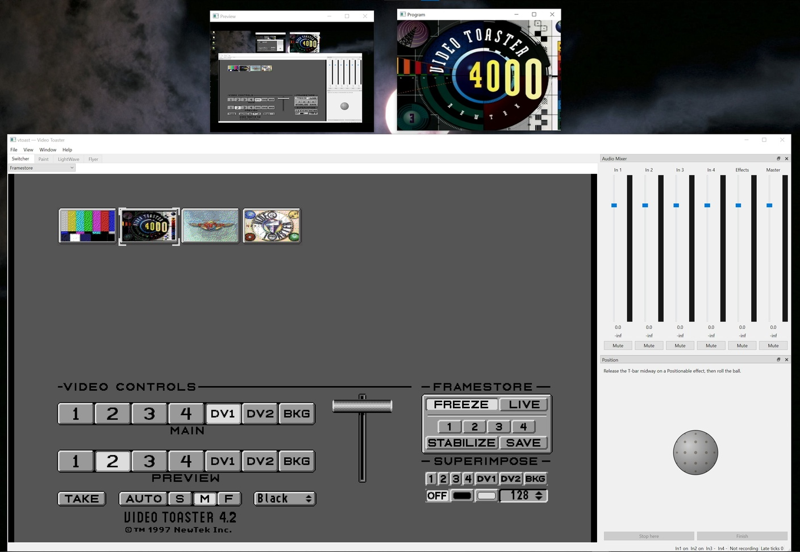

# Video Toaster Reborn

> **Work in progress.** This project is under active development. Features are incomplete, behaviour may change, and some parts are missing entirely.

A recreation of the NewTek Video Toaster 4000 (software from the v4.3 CD) for modern Windows, written in C++20 and Qt 6. It starts with the **Switcher**: the original's panel, buses, effects library and keyer, rebuilt from reverse engineering of `switcher.main` and the original data files, so the original croutons (effects, framestores, CG pages) play as they did.

## Status

Working now:

- **Switcher panel**: the original screen, Main / Preview / Superimpose buses, four inputs, DV1 / DV2, BKG colours, T-bar, Auto, Take, speed buttons.
- **Effects library**: the croutons in `Effects/` play, including ALGO wipes and digital moves, ANIM effects, ChromaFX, DVE moves, the Bar croutons, and control croutons. The four Positionable effects are placed with an on-screen trackball.
- **Keyer**: luma key (OFF / Black / White, clip level) and the Art Card Key.
- **Framestores**: FREEZE / LIVE, instant grab 1-4, STABILIZE, SAVE (1 Field / 4 Fields, written in the original's 16-plane composite format), and loading stills from the Framestore drawers.
- **ToasterCG pages**: framestore pages, key pages (dissolve on and off over Main), and scroll and crawl pages.
- **Inputs and output**: video files, capture devices or the screen as inputs; Program recorded to a file; an audio mixer.

Not yet:

- The project Sequencer (and the Blank / Stop croutons), and project files.
- The ToasterCG editor (typing and laying out new pages), ToasterPaint, LightWave, and the Flyer.

Where the original program doesn't say how the hardware behaves (for example how a key or CG page blends), the choice is marked as a guess in the code (`HardwareGuesses`) so it can be adjusted by eye.

## Requirements

- Windows 10 or later.
- **Your own Video Toaster v4.3 CD image** (not included). See [Toaster data](#toaster-data).
- To build:
  - Visual Studio 2022 Build Tools (MSVC, x64), CMake 3.25 or later, and Ninja.
  - Qt 6.8.3 (`msvc2022_64`).
  - FFmpeg 9.0.2 (full, shared build).
  - [7-Zip](https://www.7-zip.org/), to extract the Toaster data.

By default the build looks for Qt in `../Qt/6.8.3/msvc2022_64` and FFmpeg in `../ffmpeg-9.0.2-full_build-shared`, next to the repository. Set the CMake cache variables `VT_QT_DIR` and `VT_FFMPEG_DIR` to use other locations.

## Toaster data

The Toaster's software and data are copyrighted, so they are not in this repository. Before building, extract them from your own image of the Video Toaster v4.3 CD. With [7-Zip](https://www.7-zip.org/) installed, run this from the repository root:

```bat
tools\extract_disc.bat "path\to\Video Toaster v4.3.iso"
```

The path can be absolute or relative to the folder you run the command from, for example `"..\discs\Video Toaster v4.3.iso"`. Keep the quotes if it contains spaces.

The script unpacks the disc's `4.2\` folder into `data\`, which git ignores, then checks `switcher.main` to confirm it is the right disc. Running it again overwrites the same files.

It has to be the v4.3 CD: the v4.2 CD is laid out differently and has a different `switcher.main`, so the script refuses it.

Builds find `data\` on their own. Set the CMake cache variable `VT_DATA_ROOT` to use another folder. A packaged app has to be told where the data is: in **Settings > Toaster data**, choose the folder that contains `4.2\Programs\switcher.main` (the `data\` folder).

## Building

```bat
tools\build.bat
```

This configures, builds (Release, Ninja) and runs the tests. Extra arguments go to `ctest`, for example `tools\build.bat -R vt_tests`. The app is `build\msvc\app\vtoast.exe`.

`tools\dist.bat` does the same, then packages the app with everything it needs to run (Qt, FFmpeg and the MSVC runtime) as `build\dist\vtoast-reborn-alpha-<commit>\` and a `.zip` of it.

## Layout

| Folder    | What it holds                                                                                  |
| --------- | ---------------------------------------------------------------------------------------------- |
| `engine/` | The Switcher model and every effect renderer (no Qt)                                           |
| `media/`  | Inputs, decoding, the program loop, audio and recording (FFmpeg)                               |
| `assets/` | The Switcher panel and crouton icons, read from the original files                             |
| `app/`    | The Qt application                                                                             |
| `cli/`    | `vt_render` (renders one effect to frames) and `vt_show` (runs a scripted show and records it) |
| `tests/`  | Engine, media and app tests, with golden data from reference models                            |
| `tools/`  | Build script, golden generators and contact-sheet scripts                                      |
| `docs/`   | Design documents and implementation plans                                                      |

## License

vtoast_reborn is free software: you can redistribute it and/or modify it under the terms of the GNU General Public License as published by the Free Software Foundation, either version 3 of the License, or (at your option) any later version. See [LICENSE](LICENSE).

Third-party parts keep their own licenses: FFmpeg (the GPLv3 build vtoast links), Qt 6 (LGPLv3) and Catch2 (Boost Software License 1.0, `third_party/catch2`, tests only). The Video Toaster software and data you extract from the CD are not covered by this license.

## Disclaimer

This is an unofficial fan project. It is not affiliated with or endorsed by NewTek. Video Toaster is a trademark of its owner. No original Video Toaster software or data is included in this repository.
